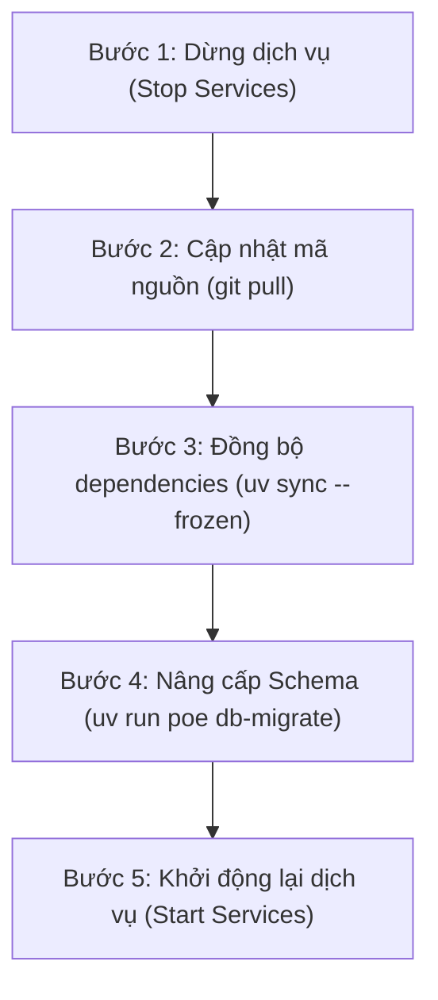

# ReconHub — Hướng dẫn vận hành hệ thống (Operations Guide)

Tài liệu hướng dẫn toàn diện dành cho Quản trị viên hệ thống (System Administrator) và Đội ngũ vận hành (DevOps/SRE) của ứng dụng **ReconHub**.

---

## Mục lục
1. [Kiến trúc hệ thống và Dịch vụ](#1-kiến-trúc-hệ-thống-và-dịch-vụ)
2. [Cài đặt triển khai mới](#2-cài-đặt-triển-khai-mới)
   - [2.1 Triển khai trên Windows Server](#21-triển-khai-trên-windows-server)
   - [2.2 Triển khai trên Linux Server](#22-triển-khai-trên-linux-server)
3. [Quy trình nâng cấp phiên bản (5 bước chuẩn)](#3-quy-trình-nâng-cấp-phiên-bản-5-bước-chuẩn)
4. [Sao lưu và Khôi phục cơ sở dữ liệu (Backup & Restore)](#4-sao-lưu-và-khôi-phục-cơ-sở-dữ-liệu-backup--restore)
5. [Xử lý sự cố thường gặp (Troubleshooting)](#5-xử-lý-sự-cố-thường-gặp-troubleshooting)
   - [5.1 Khôi phục Job treo (Stale / Orphaned Jobs)](#51-khôi-phục-job-treo-stale--orphaned-jobs)
   - [5.2 Mất kết nối VPN hoặc gián đoạn mạng Oracle](#52-mất-kết-nối-vpn-hoặc-gián-đoạn-mạng-oracle)
   - [5.3 Cảnh báo dung lượng đĩa do dữ liệu tạm](#53-cảnh-báo-dung-lượng-đĩa-do-dữ-liệu-tạm)
6. [Quản trị bảo mật và Xoay Secret Key](#6-quản-trị-bảo-mật-và-xoay-secret-key)
7. [Đổi DB RECON_APP (Chuyển SQLite sang Oracle)](#7-đổi-db-recon_app-chuyển-sqlite-sang-oracle)
8. [Dọn dẹp dữ liệu tạm thủ công định kỳ](#8-dọn-dẹp-dữ-liệu-tạm-thủ-công-định-kỳ)

---

## 1. Kiến trúc hệ thống và Dịch vụ

ReconHub được thiết kế chạy trực tiếp bằng Python 3.12 (không sử dụng Docker), gồm 2 tiến trình độc lập:
1. **Web Server (`ReconHub-Web`):**
   - Windows: Chạy bằng **Waitress** WSGI server (`app.wsgi:server`) trên cổng 8050.
   - Linux: Chạy bằng **Gunicorn** WSGI server (`app.wsgi:server`) với 4 workers đằng sau Nginx reverse proxy.
2. **Background Worker (`ReconHub-Worker`):**
   - Chạy lệnh `python -m worker`.
   - Liên tục lắng nghe hàng đợi `RECON_RUN_QUEUE`, nhận job có trạng thái `QUEUED`, cập nhật tiến độ (Progress 0–100%) và thực thi đối soát qua Polars engine.
3. **Cơ sở dữ liệu ứng dụng (RECON_APP):**
   - Mặc định sử dụng **SQLite** (`data/recon_app.db`) ở chế độ Write-Ahead Logging (WAL).
   - Có thể chuyển đổi sang **Oracle Database** khi hệ thống mở rộng nhiều người dùng đồng thời.

---

## 2. Cài đặt triển khai mới

### 2.1 Triển khai trên Windows Server
Môi trường khuyến nghị: Windows Server 2019/2022 64-bit.

1. **Chuẩn bị môi trường:**
   - Cài đặt Python 3.12 và công cụ `uv`.
   - Tải `nssm.exe` (bản win64) đặt tại `deploy\windows\nssm.exe` hoặc thư mục trong `PATH`.
2. **Cài đặt mã nguồn:**
   ```powershell
   cd D:\reconhub
   uv sync --extra prod
   Copy-Item .env.example .env
   notepad .env  # Cấu hình SECRET KEY và chuỗi kết nối
   uv run poe db-migrate
   uv run python -m app.cli create-admin --username admin --password "MatKhauKhoDoan123" --fullname "Quản Trị Viên"
   ```
3. **Đăng ký Windows Service & Tác vụ sao lưu:**
   ```powershell
   cd D:\reconhub\deploy\windows
   .\install-services.ps1 -Port 8050 -Threads 4
   .\backup-task.ps1 -Time "01:00"
   ```
4. **Kiểm tra dịch vụ:**
   ```powershell
   Get-Service ReconHub-Web, ReconHub-Worker
   ```

### 2.2 Triển khai trên Linux Server
Môi trường khuyến nghị: Ubuntu Server 22.04/24.04 LTS hoặc RHEL/Rocky Linux 9.

1. **Chuẩn bị thư mục và mã nguồn:**
   ```bash
   sudo mkdir -p /opt/reconhub
   sudo chown -R $USER:$USER /opt/reconhub
   git clone <REPO_URL> /opt/reconhub
   cd /opt/reconhub
   uv sync --extra prod
   cp .env.example .env
   nano .env
   uv run poe db-migrate
   uv run python -m app.cli create-admin --username admin --password "MatKhauKhoDoan123" --fullname "Quản Trị Viên"
   ```
2. **Cài đặt Systemd Services & Nginx:**
   ```bash
   cd /opt/reconhub/deploy/linux
   sudo chmod +x install.sh
   sudo ./install.sh
   sudo cp nginx.conf /etc/nginx/sites-available/reconhub
   sudo ln -s /etc/nginx/sites-available/reconhub /etc/nginx/sites-enabled/
   sudo nginx -t && sudo systemctl reload nginx
   ```

---

## 3. Quy trình nâng cấp phiên bản (5 bước chuẩn)

Khi phát hành bản vá hoặc cập nhật tính năng mới, tuân thủ nghiêm ngặt quy trình 5 bước sau để đảm bảo tính toàn vẹn dữ liệu:



### Chi tiết trên Windows:
```powershell
# Bước 1: Dừng các dịch vụ
Stop-Service ReconHub-Web
Stop-Service ReconHub-Worker

# Bước 2: Cập nhật mã nguồn
git pull origin main

# Bước 3: Đồng bộ gói thư viện khóa phiên bản
uv sync --frozen --extra prod

# Bước 4: Chạy migration schema
uv run poe db-migrate

# Bước 5: Khởi động lại dịch vụ
Start-Service ReconHub-Web
Start-Service ReconHub-Worker
```

### Chi tiết trên Linux:
```bash
# Bước 1: Dừng các dịch vụ
sudo systemctl stop reconhub-worker.service
sudo systemctl stop reconhub-web.service

# Bước 2: Cập nhật mã nguồn
git pull origin main

# Bước 3: Đồng bộ gói thư viện
uv sync --frozen --extra prod

# Bước 4: Chạy migration schema
uv run poe db-migrate

# Bước 5: Khởi động lại dịch vụ
sudo systemctl start reconhub-web.service
sudo systemctl start reconhub-worker.service
```

---

## 4. Sao lưu và Khôi phục cơ sở dữ liệu (Backup & Restore)

### 4.1 Cơ chế sao lưu SQLite
ReconHub áp dụng phương thức `VACUUM INTO` kết hợp `PRAGMA wal_checkpoint(TRUNCATE)` để tạo bản sao lưu vật lý độc lập, bảo đảm tính nhất quán dữ liệu ở mức độ giao dịch kể cả khi hệ thống đang hoạt động.
- Bản sao lưu được lưu tại thư mục `backup/` với định dạng tên `recon_app_YYYYMMDD_HHMMSS.db`.
- Cơ chế tự động xoay vòng giữ đúng **14 bản sao lưu gần nhất**, tự động xóa các bản cũ hơn.

### 4.2 Lệnh sao lưu thủ công
```bash
# Thực hiện sao lưu ngay lập tức (giữ 14 bản)
uv run python -m app.cli backup

# Tùy chỉnh thư mục lưu trữ và số bản giữ lại
uv run python -m app.cli backup --dest D:\backups\reconhub --keep 30
```

### 4.3 Quy trình khôi phục cơ sở dữ liệu (Restore)
Trước khi khôi phục, hệ thống sẽ tự động tạo một bản lưu an toàn (`.db.pre_restore_bak`) của cơ sở dữ liệu hiện tại.

```powershell
# 1. Dừng các dịch vụ trước khi khôi phục
Stop-Service ReconHub-Web, ReconHub-Worker

# 2. Khôi phục từ file backup chỉ định
uv run python -m app.cli restore --file backup/recon_app_20261101_010000.db

# 3. Khởi động lại dịch vụ
Start-Service ReconHub-Web, ReconHub-Worker
```

---

## 5. Xử lý sự cố thường gặp (Troubleshooting)

### 5.1 Khôi phục Job treo (Stale / Orphaned Jobs)
**Hiện tượng:** Tiến trình server hoặc máy chủ bị tắt đột ngột (mất điện, crash) khi đang chạy đối soát khiến run bị kẹt ở trạng thái `RUNNING` trên giao diện.

**Khắc phục:**
- Khi `ReconHub-Worker` khởi động lại, worker tự động quét và đánh dấu toàn bộ job mồ côi (`RUNNING` nhưng không có heartbeat) chuyển về trạng thái `FAILED` kèm thông báo lỗi rõ ràng.
- Hoặc quản trị viên có thể chạy lệnh khôi phục thủ công qua Python:
  ```bash
  uv run python -c "from app.services.run_executor import reset_stale_jobs; print(reset_stale_jobs(timeout_seconds=900))"
  ```

### 5.2 Mất kết nối VPN hoặc gián đoạn mạng Oracle
**Hiện tượng:** Run thất bại ở Stage 3 (Truy vấn DB) với thông báo lỗi ORA-12170 (TNS:Connect timeout) hoặc mất gói tin.

**Khắc phục:**
1. Kiểm tra kết nối mạng VPN tới server Oracle:
   ```powershell
   Test-NetConnection -ComputerName 10.x.x.x -Port 1521
   ```
2. Nếu VPN bị ngắt, kết nối lại VPN trên máy chủ.
3. Người dùng chỉ cần bấm nút **"Chạy lại"** trên màn hình Kết quả run để thực thi lại mà không cần tải lại file Excel.

### 5.3 Cảnh báo dung lượng đĩa do dữ liệu tạm
**Hiện tượng:** Banner cảnh báo màu vàng hiển thị trên Header: *"Dung lượng dữ liệu tạm đã vượt 10 GB"*.

**Khắc phục:**
- ReconHub tuân thủ nguyên tắc **không bao giờ tự ý xóa dữ liệu tạm của người dùng**.
- Xem mục 8 để thực hiện dọn dẹp theo khoảng thời gian đã kiểm tra.

---

## 6. Quản trị bảo mật và Xoay Secret Key

### 6.1 Các khóa bí mật trong hệ thống
- `FLASK_SECRET_KEY`: Khóa ký session cookie của người dùng.
- `RECON_SECRET_KEY`: Khóa mã hóa đối xứng AES-128 Fernet dùng để bảo vệ mật khẩu đăng nhập của các Data Source Oracle.

### 6.2 Xoay `FLASK_SECRET_KEY`
1. Thay đổi giá trị `FLASK_SECRET_KEY` trong file `.env`.
2. Khởi động lại `ReconHub-Web`.
3. Toàn bộ phiên đăng nhập hiện tại sẽ hết hiệu lực; người dùng cần đăng nhập lại.

### 6.3 Xoay `RECON_SECRET_KEY`
1. Cần thực hiện trước khi cập nhật `.env`: giải mã mật khẩu các Data Source cũ bằng key cũ và mã hóa lại bằng key mới.
2. Cập nhật `RECON_SECRET_KEY` mới trong `.env`.
3. Khởi động lại các dịch vụ.

### 6.4 Quản trị tài khoản Admin qua CLI
```bash
# Đặt lại mật khẩu khi quản trị viên quên mật khẩu
uv run python -m app.cli reset-password --username admin --password "MatKhauMoi123@"

# Tạo thêm tài khoản quản trị viên mới
uv run python -m app.cli create-admin --username admin_sec --full-name "Admin Dự Phòng" --password "MatKhau123@" --force
```

---

## 7. Đổi DB RECON_APP (Chuyển SQLite sang Oracle)

ReconHub hỗ trợ chuyển toàn bộ metadata, cấu hình template, lịch sử chạy và dữ liệu đối soát từ SQLite nội bộ sang hệ quản trị cơ sở dữ liệu Oracle thông qua công cụ tự động.

### 7.1 Điều kiện tiên quyết
1. Đã đăng ký Data Source Oracle đích trong màn hình **Data Sources** với cờ hoạt động (`IS_ACTIVE = Y`).
2. Schema đích trên Oracle phải là schema mới hoặc schema trống (không chứa các bảng `RECON_*` có dữ liệu). Nếu có bảng cũ từ lần chuyển thử nghiệm trước, sử dụng chức năng **Xóa schema đích** để dọn dẹp.
3. Không có run nào đang ở trạng thái chờ (`QUEUED`) hoặc đang xử lý (`RUNNING`).

### 7.2 Các bước thực hiện
Hệ thống hỗ trợ 2 cách chuyển:

#### Cách 1: Qua giao diện Web (Khuyên dùng)
1. Đăng nhập với vai trò **Quản trị viên (Admin)**.
2. Vào màn hình **Data Sources** > chọn tab **Lưu trữ RECON_APP**.
3. Tại khối **Chuyển dữ liệu sang Oracle**:
   - Chọn Data Source Oracle đích.
   - Chọn chế độ chuyển:
     - `NO_TEMP` *(Mặc định)*: Chuyển toàn bộ cấu hình, lịch sử và kết quả đối soát; bỏ qua dữ liệu Excel tạm.
     - `FULL`: Chuyển tất cả bao gồm cả dữ liệu dòng Excel tạm.
     - `CONFIG_ONLY`: Chỉ chuyển cấu hình (user, template, data source), không chuyển lịch sử chạy.
   - Nhấn nút **Kiểm tra trước (Precheck)** để hệ thống xác thực tính sẵn sàng và tính toán dung lượng ước tính.
   - Nhấn **Chuyển sang Oracle**. Hệ thống sẽ tự động bật chế độ bảo trì, khởi tạo schema trên Oracle, sao chép dữ liệu theo lô 5.000 dòng, đồng bộ sequence/identity và đối chiếu số dòng + SHA256 checksum.

#### Cách 2: Qua dòng lệnh CLI
```bash
# Xem trước điều kiện (Dry-run)
uv run python -m app.cli migrate-metadata --target-ds <ID_ORACLE> --mode NO_TEMP --dry-run

# Thực hiện chuyển dữ liệu thật
uv run python -m app.cli migrate-metadata --target-ds <ID_ORACLE> --mode NO_TEMP
```

### 7.3 Cập nhật biến môi trường và khởi động lại
Sau khi phiên chuyển báo cáo trạng thái `DONE`:
1. Dừng ứng dụng web ReconHub và background worker.
2. Mở file `.env` trên máy chủ và cập nhật chuỗi kết nối:
   ```env
   RECON_DB_URL=oracle+oracledb://<USERNAME>:<PASSWORD>@<HOST>:<PORT>/?service_name=<SERVICE_NAME>
   ```
3. Chạy lệnh kiểm tra schema:
   ```bash
   uv run poe db-migrate
   ```
4. Khởi động lại dịch vụ web và worker.

### 7.4 Quản lý bản lưu SQLite cũ
- Sau khi chuyển đổi thành công, file SQLite gốc (ví dụ `data/recon_app.db`) được giữ nguyên làm bản lưu dự phòng an toàn.
- Hệ thống **tuyệt đối không tự ý xóa** file SQLite cũ.
- Khi hệ thống đã vận hành ổn định trên Oracle và Admin muốn giải phóng dung lượng đĩa:
  - Truy cập tab **Lưu trữ RECON_APP** trên giao diện Web (chỉ kích hoạt khi ứng dụng đang kết nối Oracle).
  - Tại khối **Bản lưu SQLite cũ**, nhấn **Xóa bản lưu**.
  - Nhập chính xác tên file xác nhận (ví dụ `recon_app.db`) để xóa file vật lý và ghi nhật ký kiểm toán (`RECON_PURGE_LOG`, `RECON_AUDIT_LOG`).

---

## 8. Dọn dẹp dữ liệu tạm thủ công định kỳ

Theo quy định thiết kế nghiệp vụ ReconHub (spec 04 mục 12):
> Dữ liệu Excel tạm (file upload gốc, các dòng Excel tạm nạp vào DB, file export cache) **chỉ bị xóa khi người dùng chủ động yêu cầu**. Kết quả đối soát, tổng hợp số liệu và chênh lệch **luôn được bảo toàn vĩnh viễn**.

### 8.1 Dọn dẹp qua dòng lệnh CLI
Quản trị viên có thể lên lịch hoặc thực hiện dọn dẹp các run cũ đã kiểm tra xong để giải phóng dung lượng đĩa:

```bash
# Xem trước số lượng run và dung lượng sẽ được dọn dẹp (Dry-run)
uv run python -m app.cli purge-temp --checked-before 2026-01-01 --dry-run

# Thực hiện xóa dữ liệu tạm của các run đã kiểm tra trước ngày chỉ định
uv run python -m app.cli purge-temp --checked-before 2026-01-01

# Xóa dữ liệu tạm của một run cụ thể
uv run python -m app.cli purge-temp --run 1042
```

### 8.2 Dọn dẹp qua giao diện Web
- **Màn hình Lịch sử run (`/history`):** Người dùng có thể tích chọn nhiều run đã hoàn thành và nhấn nút *"Xóa dữ liệu tạm đã chọn"*.
- **Màn hình Kết quả run (`/runs/<id>`):** Khi nhấn *"Đã kiểm tra xong"*, người dùng có tùy chọn đánh dấu tích *"Xóa luôn dữ liệu tạm của run này"*.
- **Màn hình Lưu trữ RECON_APP (`/data-sources` tab Lưu trữ):** Admin có thể xóa hàng loạt theo điều kiện ngày kiểm tra.
