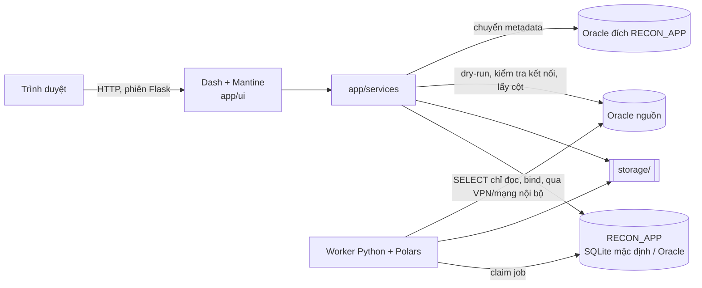

# Spec 01 – Kiến trúc và quyết định kiến trúc (ADR)

## 1. Sơ đồ

## 2. Thành phần

| Thành phần | Trách nhiệm |
|---|---|
| app/ui | Dash pages + callbacks, theme DMC, AppShell. Không chứa nghiệp vụ |
| app/services | Nghiệp vụ, kiểm quyền, transaction, audit; trả ServiceResult |
| app/engine | Hàm thuần xử lý dữ liệu |
| app/repo + app/db | SQLAlchemy Core, chạy trên SQLite và Oracle |
| app/routes | Flask: /health, /login, /logout, /download/file/<id>, /download/export/<run_id> |
| app/cli.py | create-admin, reset-password, purge-temp, migrate-metadata |
| worker | Lấy job, gọi `services.run_executor`, heartbeat; chạy job chuyển metadata |
| storage/ | `files/<sha256>.<ext>`, `runs/<run_id>/excel.parquet`, `db.parquet`, `export.xlsx` |

## 3. ADR

**ADR-001 Python + Polars cho engine.** Đọc Excel và xử lý dataframe nhanh, join/group_by nhanh với 1 triệu dòng.

**ADR-002 Hàng đợi bằng bảng trong RECON_APP.** Không Redis/Celery. SQLite: `UPDATE … RETURNING` trong `BEGIN IMMEDIATE`; Oracle: `FOR UPDATE SKIP LOCKED`; heartbeat, reset job treo.

**ADR-003 Cấu hình template là JSON có version**, validate bằng Pydantic `TemplateConfig`.

**ADR-004 Kết quả lưu JSON động** (KEY/EXCEL/DB/DIFF), kèm metadata cột để dựng grid.

**ADR-005 Đẩy phép gộp xuống Oracle nguồn** bằng SQL GROUP BY sinh tự động; giảm dữ liệu đi qua VPN.

**ADR-006 Tham số thời gian do người dùng nhập**, dùng chung cho DB và Excel.

**ADR-007 Nguồn khai báo theo bảng/view là mặc định.** Định danh lấy từ metadata DB (whitelist) và được quote. SQL tự viết qua SQL guard.

**ADR-008 Kiểu số Decimal(38,4)**, so sánh sau khi làm tròn.

**ADR-009 Giao diện Dash + dash-mantine-components** (DMC 2.x, Mantine v8) + dash-ag-grid. Một ngôn ngữ Python, không build frontend. Đánh đổi: tương tác phức tạp viết bằng callback/clientside callback; bước 4 wizard dùng nút thay kéo thả.

**ADR-010 Người dùng và đăng nhập trong RECON_APP (chốt 31/10/2026, thay Entra ID).** Bảng `RECON_USER` + `RECON_USER_ROLE`; mật khẩu argon2id, không ràng buộc độ phức tạp (chỉ không rỗng); khóa tạm sau nhiều lần sai; phiên Flask có `SESSION_VERSION` để thu hồi. Admin đầu tiên tạo bằng CLI. Không SSO.

**ADR-011 RECON_APP mặc định SQLite, chuyển được sang Oracle (chốt 31/10/2026).** Một máy chủ, ít người dùng, dữ liệu Excel là tạm: SQLite (file local, WAL) đủ dùng, không cần DB server. Giới hạn: Dash + worker cùng máy, file trên ổ local, một luồng ghi tại một thời điểm. Khi cần nhiều máy chủ hoặc lưu tập trung: chuyển sang Oracle (spec 08).

**ADR-012 Dữ liệu tạm xóa theo yêu cầu (chốt 31/10/2026).** Không tự xóa. Người dùng xóa từng run, nhiều run, theo điều kiện; Admin xóa file SQLite cũ sau khi chuyển. Hệ thống chỉ cảnh báo khi vượt ngưỡng (spec 04 mục 12).

**ADR-013 Không Docker (chốt 31/10/2026).** Dev: Windows, chạy Python trực tiếp, Oracle server qua VPN (python-oracledb Thin, không Oracle Client). Triển khai: chạy trực tiếp trên server; Windows dùng waitress + Windows Service (NSSM hoặc pywin32), Linux dùng gunicorn + systemd (task 16). Lệnh qua poethepoet để dùng chung Windows/Linux.

## 4. Giới hạn MVP
- Tối đa 1.000.000 dòng mỗi phía; file tối đa 50MB.
- Một worker xử lý một run tại một thời điểm; chạy được nhiều worker trên cùng máy.
- Qua VPN: `RUN_DB_CALL_TIMEOUT_SECONDS` mặc định 600.
- SQLite: một máy chủ; khi file RECON_APP > 20GB hoặc cần nhiều máy chủ thì chuyển sang Oracle.

## 5. Môi trường
DEV: máy Windows cá nhân (SQLite file, Oracle test qua VPN). UAT/PROD: server Windows hoặc Linux, chạy trực tiếp (task 16).
