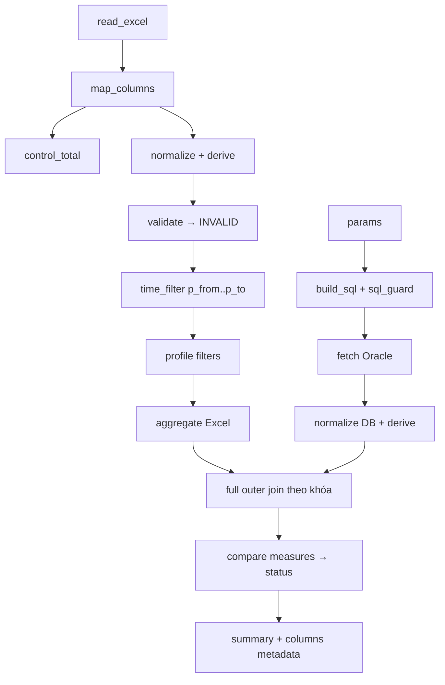

# Spec 04 – Engine đối soát

Module `app/engine/`. Mọi hàm (trừ `fetch.py`, `catalog.py`) là hàm thuần, nhận DataFrame + cấu hình Pydantic, trả DataFrame và cảnh báo.

## 0. Pipeline

| File | Hàm chính |
|---|---|
| reader.py | `list_sheets`, `read_sheet(path, FileSpec) -> (df, header_map)` (có `__row_no`) |
| mapping.py | `resolve_columns`, `detect_template` |
| control_total.py | `check_control_total` |
| normalize.py | `normalize(df, fields, side) -> (df, invalid_df)`, `derive` |
| filters.py | `apply_row_filters`, `apply_time_filter`, `apply_profile_filters` |
| aggregate.py | `aggregate(df, profile)` |
| catalog.py | `list_tables`, `list_columns`, `describe_sql` (nhận connection) |
| sql_dialect.py | `quote`, `trunc_day`, `trunc_month`, `concat`, `substr` cho Oracle nguồn |
| sql_guard.py | `check_sql` |
| sql_builder.py | `build_source_sql(config, profile) -> (sql, binds)` |
| fetch.py | `fetch_df(conn, sql, binds, max_rows, timeout)` |
| compare.py | `compare(excel_agg, db_agg, profile)` |
| summary.py | `build_summary`, `columns_metadata` |
| export.py | `write_export` |
| inspect.py | `inspect_sample` (gợi ý cho wizard) |
| pipeline.py | `run_pipeline(excel_path, config, profile_code, params, fetcher)` |

## 1. Đọc Excel
- `pl.read_excel(..., engine="calamine", has_header=False, infer_schema_length=0)`, tự cắt header theo `header_row`. Mọi cột `Utf8`.
- Ô số → chuỗi không mất chính xác (int → `str(int)`, float nguyên bỏ `.0`). Ô ngày → ISO.
- `__row_no` = số dòng thật trong file. Header trùng → hậu tố `__2` + cảnh báo.
- CSV: UTF-8 / UTF-8-SIG, tự nhận `,` `;` tab.

## 2. Mapping và chuẩn hóa
- So header sau trim, gộp khoảng trắng, không phân biệt hoa thường, NFC; thử `excel` rồi `excel_aliases`. Thiếu cột required hoặc cột profile cần → `EXCEL_COLUMN_MISSING`.
- number: bỏ thousand_sep, đổi decimal_sep, rỗng → null, lỗi → INVALID `PARSE_NUMBER`; kiểu Decimal(38,4).
- date/datetime: theo `format`, số → Excel serial (gốc 1899-12-30), ISO; lỗi → INVALID `PARSE_DATE`.
- required null → INVALID `MISSING_KEY`/`MISSING_REQUIRED`.
- Phía DB áp cùng norm text (trim/upper/value_map/lpad).

## 3. Control total
Tìm dòng tổng trên dữ liệu thô; `calc` = Σ value_col các dòng dữ liệu (sau row_filters, trước lọc thời gian); `ok` khi |calc − file| ≤ tolerance; không thấy dòng tổng → cảnh báo `CONTROL_TOTAL_NOT_FOUND`. Sample: 366.732.000.

## 4. Tham số thời gian
- `p_from`, `p_to` datetime naive giờ VN, bắt buộc, `p_from ≤ p_to` (`INVALID_RANGE`), khoảng ≤ max_range_days (`RANGE_TOO_LARGE`). granularity=date: cắt 00:00:00 và 23:59:59.999.
- Excel (nếu `apply_range_excel` và có `excel_field`): giữ dòng trong khoảng; đếm `EXCEL_ROWS_OUT_OF_RANGE`, lưu tối đa 1000 số dòng đầu.
- DB: bind datetime.

## 5. Gộp
- sum (null bỏ qua), count (`pl.len()`), count_distinct, min, max, first_distinct (≥ 2 giá trị → cờ inconsistent + danh sách). `__row_nos`, `__rows`.
- aggregate=false: khóa lặp → DUPLICATE.
- Khóa chuẩn: chuỗi chuẩn hóa theo kiểu; `__key` nối `\x1f`; KEY_TEXT nối ` | `.

## 6–7. Ghép và so sánh
- Full outer join theo `__key`; tiền tố `x__`, `d__`.
- Làm tròn theo `round` (ROUND_HALF_UP); null_as; exact; abs_tol |a−b| ≤ t; pct_tol |a−b| ≤ t/100 × max(|a|,|b|).
- Trạng thái theo ưu tiên spec 00 mục 3. Sắp xếp: trạng thái, |diff main| giảm dần, KEY_TEXT.

## 8. SQL nguồn (Oracle)
### 8.1 Guard (kind=sql)
Bỏ comment và literal; bắt đầu SELECT/WITH; không `;`; không INSERT, UPDATE, DELETE, MERGE, DROP, CREATE, ALTER, TRUNCATE, GRANT, REVOKE, BEGIN, DECLARE, EXECUTE, EXEC, CALL, COMMIT, ROLLBACK, LOCK, FOR UPDATE, DBMS_, UTL_, `@`; bind phải thuộc params; có p_from, p_to. Lỗi `SQL_NOT_ALLOWED` kèm lý do tiếng Việt.
### 8.2 Catalog
`list_tables` (ALL_TABLES + ALL_VIEWS theo OWNER, tìm theo tên, tối đa 200), `list_columns` (ALL_TAB_COLUMNS); kind=sql: `SELECT * FROM (<sql>) WHERE 1=0`. Cache 10 phút.
### 8.3 SQL sinh ra
- kind=table: `SELECT <cột đã map> FROM "SCHEMA"."TABLE" WHERE <filters> AND <static_where>`; định danh trong whitelist, quote; giá trị bind `:name`.
- pushdown_aggregate + aggregate: bọc `SELECT <khóa>, <agg> FROM (<sql nguồn>) src WHERE <profile filters> GROUP BY <khóa>`; norm text áp trong SQL (`UPPER(TRIM(col))`, value_map → CASE); first_distinct → `MIN(expr)` + `COUNT(DISTINCT expr)`.
- Không pushdown: kéo chi tiết, đếm dần, vượt max_rows → `SOURCE_TOO_MANY_ROWS`.
### 8.4 Fetch
`conn.call_timeout = timeout_s*1000`, `arraysize=10000`, `fetch_decimals=True`. Mất kết nối (VPN) → `SOURCE_CONNECTION_LOST`, run FAILED, không ghi kết quả dở.

## 9. Run executor (`services/run_executor.py`)
1. READ (10%): đọc, mapping, control total, normalize, validate.
2. FILTER (25%): nạp dòng đã chuẩn hóa vào RECON_EXCEL_LOAD/ROW (bỏ qua nếu đã nạp cùng file + version và chưa xóa); lọc thời gian, profile; gộp Excel; cache `excel.parquet`.
3. FETCH_DB (55%): build SQL, guard, fetch, normalize; cache `db.parquet`.
4. COMPARE (80%): join, compare, summary.
5. SAVE (100%): ghi RECON_RESULT_* lô 5.000, SUMMARY, status DONE.
Lỗi → FAILED với ERROR_CODE, ERROR_MSG tiếng Việt. Dry-run dùng executor với `persist=False`.

## 10. Export
XlsxWriter. Sheet Tổng hợp (tham số, control total, đếm, tổng tiền); mỗi trạng thái ≠ MATCHED một sheet (khóa, Trạng thái, mỗi measure Excel/DB/Chênh, Số dòng Excel); sheet Không hợp lệ. Cột khóa `@` Text, `write_string`. Ô lệch tô `#FDECEC` (ngoại lệ hex duy nhất, đặt ở `export_styles.py`). Export sinh từ RECON_RESULT_* nên vẫn dùng được sau khi xóa dữ liệu tạm.

## 11. Inspect (wizard bước 1)
Số dòng/cột; dòng tổng ứng viên; cột lẫn số và chữ; cột có số 0 ở đầu; cột ngày; cột ứng viên khóa và tỉ lệ duy nhất; gợi ý tên trường (bỏ dấu, UPPER_SNAKE) và kiểu.

## 12. Dữ liệu tạm và xóa theo yêu cầu (`services/temp_data.py`)

**Dữ liệu tạm** của run: file gốc, RECON_EXCEL_LOAD/RECON_EXCEL_ROW, `storage/runs/<id>/*.parquet`, `export.xlsx`. **Giữ lại**: RECON_RUN (tham số, hash, tên file), SUMMARY, RECON_RESULT_*, issue, audit. Hệ thống **không tự xóa**.

| Thao tác | Nơi | Quyền | Hàm |
|---|---|---|---|
| Đã kiểm tra xong (đánh dấu + xóa dữ liệu tạm của run) | Kết quả run | OP, TO, AD | `run.mark_checked(ctx, run_id, purge=True)` |
| Chỉ đánh dấu đã kiểm tra, chưa xóa | Kết quả run | OP, TO, AD | `run.mark_checked(ctx, run_id, purge=False)` |
| Xóa dữ liệu tạm nhiều run đã chọn | Lịch sử | AD | `temp_data.purge_runs(ctx, run_ids)` |
| Xóa theo điều kiện (template, khoảng ngày chạy, đã/chưa kiểm tra, người chạy) | Data Sources › Lưu trữ | AD | `temp_data.preview(ctx, filter)` rồi `purge_filter(ctx, filter, confirm_text)` |
| Xóa file SQLite cũ sau khi chuyển sang Oracle | Data Sources › Lưu trữ | AD | `metadata_migration.delete_old_sqlite(ctx, migration_id, confirm_name)` |
| Xóa kết quả cũ (tùy chọn, mặc định tắt) | Data Sources › Lưu trữ | AD | `temp_data.purge_results(ctx, older_than_days, confirm_text)` |

Quy tắc:
- Không xóa run QUEUED/RUNNING. Xóa hàng loạt/điều kiện: luôn `preview` trước (số run, số dòng, dung lượng ước tính), yêu cầu gõ `XOA` để xác nhận.
- Dữ liệu dùng chung (một file/EXCEL_LOAD cho nhiều run): xóa EXCEL_LOAD và file khi **mọi** run tham chiếu đã được yêu cầu xóa; run còn lại hiện "Dữ liệu dùng chung với run #…, chưa xóa".
- Thứ tự: RECON_EXCEL_ROW theo lô 5.000 → EXCEL_LOAD.PURGED_AT → parquet/export → file gốc (FILE.PURGED_AT, STORAGE_PATH=NULL) → RUN.TEMP_PURGED_AT/BY → RECON_PURGE_LOG + audit `PURGE_TEMP` → SQLite `PRAGMA incremental_vacuum`.
- Sau khi xóa: `row_detail` trả phần Excel `{"purged_at": …}`; UI hiện "Dữ liệu Excel gốc đã xóa lúc …". Export vẫn sinh được. Chạy lại cần upload lại file.
- **Cảnh báo (không xóa)**: `temp_data.usage()` trả dung lượng dữ liệu tạm, số run chưa kiểm tra, số run giữ dữ liệu tạm quá `TEMP_WARN_DAYS`. Vượt `TEMP_WARN_GB` hoặc có run quá hạn → banner cho Admin "Dữ liệu tạm 5,2 GB, 12 run giữ quá 30 ngày. Xem và xóa" (link tới tab Lưu trữ).
- CLI: `uv run python -m app.cli purge-temp --run <id>` hoặc `--checked-before <yyyy-mm-dd>` (có `--dry-run`).
