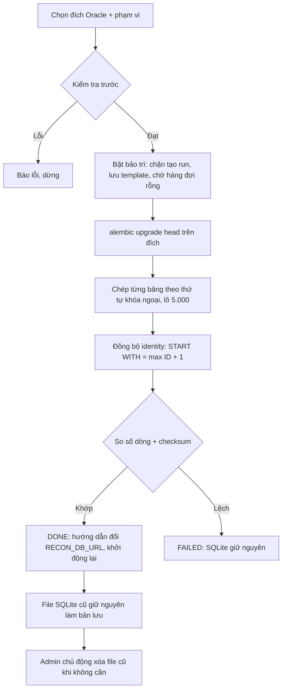

# Spec 08 – Lưu trữ RECON_APP và chuyển từ SQLite sang Oracle

## 1. Mục tiêu
Mặc định RECON_APP là file SQLite trên máy chạy ứng dụng. Khi cần nhiều máy chủ hoặc lưu tập trung, Admin chuyển dữ liệu (người dùng, data source, template, run, kết quả, audit, issue; dữ liệu tạm tùy chọn) sang một schema Oracle, rồi đổi ứng dụng sang Oracle.

## 2. Đăng ký đích Oracle
- DBA tạo schema bằng `scripts/oracle/03_create_recon_app.sql` (test: RECON_APP_TEST; thật: RECON_APP).
- Màn Data Sources › tab Lưu trữ RECON_APP › Thêm đích Oracle: host, port, service name, **user và password của schema**, schema đích.
- Kiểm tra kết nối: kết nối được; Oracle ≥ 19; quyền CREATE TABLE, CREATE SEQUENCE; quota tablespace; schema đích trống hay đã có RECON_*; Alembic version nếu có.
- DB đang dùng (theo `RECON_DB_URL`) tự có bản ghi METADATA "Đang dùng" (đường dẫn file, dung lượng), không sửa/xóa được.

## 3. Quy trình chuyển

- **Phạm vi**: NO_TEMP (mặc định, bỏ RECON_EXCEL_LOAD/ROW; run ở đích coi như đã xóa dữ liệu tạm), FULL, CONFIG_ONLY (user, vai trò, data source, template, version, issue reason, setting).
- **Kiểm tra trước**: đích Oracle; trống (không có bảng RECON_* có dữ liệu); không có run QUEUED/RUNNING; ước lượng số dòng/dung lượng theo bảng.
- **Bảo trì**: `RECON_APP_SETTING.MAINTENANCE='Y'`, banner toàn ứng dụng.
- **Thứ tự bảng**: RECON_USER, RECON_USER_ROLE, RECON_DATA_SOURCE, RECON_TEMPLATE, RECON_TEMPLATE_VERSION, RECON_FILE, RECON_EXCEL_LOAD, RECON_EXCEL_ROW, RECON_RUN, RECON_RUN_QUEUE, RECON_RUN_SUMMARY, RECON_RESULT_ROW, RECON_RESULT_DIFF, RECON_INVALID_ROW, RECON_ISSUE_REASON, RECON_ISSUE, RECON_APP_SETTING, RECON_PURGE_LOG, RECON_LOGIN_LOG, RECON_AUDIT_LOG, RECON_METADATA_MIGRATION.
- **Chép**: đọc SQLite theo khóa chính, ghi Oracle `executemany` lô 5.000; giữ nguyên ID; JSON giữ chuỗi; DEC TEXT → Decimal → NUMBER; thời gian ISO → datetime. PASSWORD_HASH chép nguyên (argon2 độc lập DB).
- **Kiểm tra**: số dòng từng bảng; checksum sha256 khóa chính cho 3 bảng lớn nhất; REPORT_JSON.
- **Đổi DB**: không đổi nóng. Màn hiện chuỗi `RECON_DB_URL` mới (không mật khẩu) và các bước: dừng web + worker → sửa .env → `uv run poe db-migrate` → khởi động. Khởi động trên Oracle: bản ghi METADATA tương ứng thành "Đang dùng"; ghi `OLD_SQLITE_PATH`.
- **File SQLite cũ**: giữ nguyên, không tự xóa. Tab Lưu trữ hiện khối "Bản lưu SQLite cũ" (đường dẫn, dung lượng, ngày chuyển) với nút **Xóa bản lưu SQLite cũ** (Admin, gõ đúng tên file để xác nhận; chỉ khi ứng dụng đang chạy trên Oracle; ghi RECON_PURGE_LOG scope OLD_SQLITE + audit).
- **Chạy lại sau lỗi**: precheck báo `MIGRATION_TARGET_NOT_EMPTY` kèm nút "Xóa bảng RECON_* trong schema đích" (gõ tên schema xác nhận).
- CLI: `uv run python -m app.cli migrate-metadata --target <id> --mode NO_TEMP`.
- MVP chỉ SQLite → Oracle.

## 4. Kiểm thử
Integration (marker `oracle`, schema `RECON_APP_TEST`): seed SQLite (users, template DTP, 2 run G01) → chuyển NO_TEMP và FULL → số dòng khớp; khởi động với `RECON_DB_URL` Oracle → đăng nhập bằng user cũ, mở run cũ đúng kết quả, tạo run mới ID không trùng. Lỗi giữa chừng (giả lập ngắt kết nối) → FAILED, SQLite không đổi. Xóa file SQLite cũ chỉ được khi đang chạy trên Oracle.
