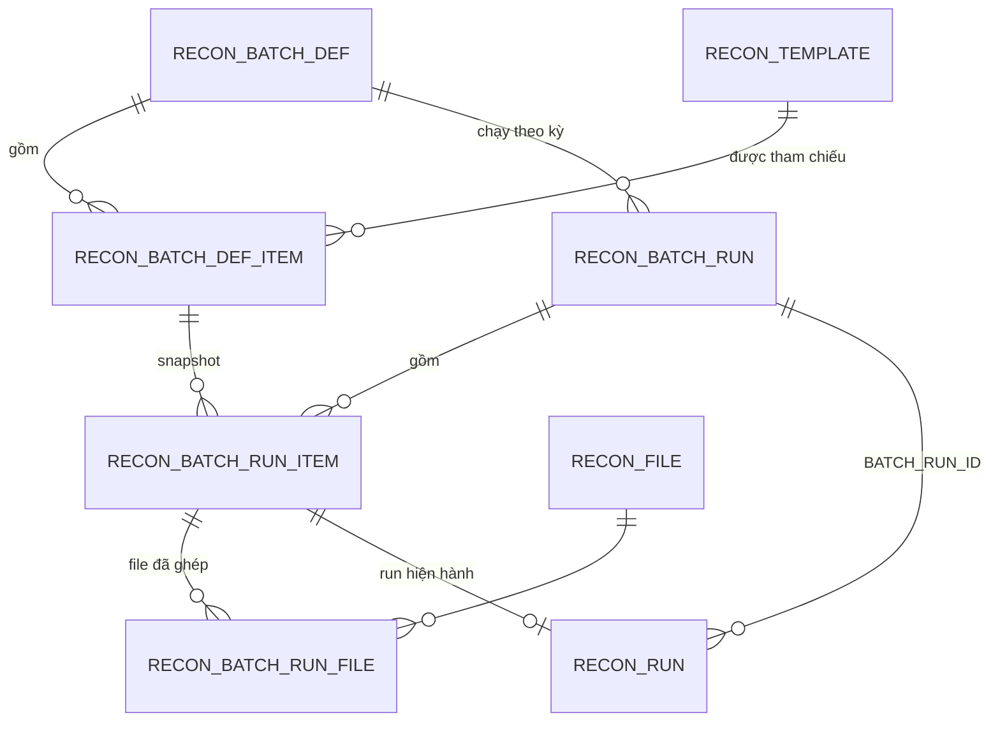
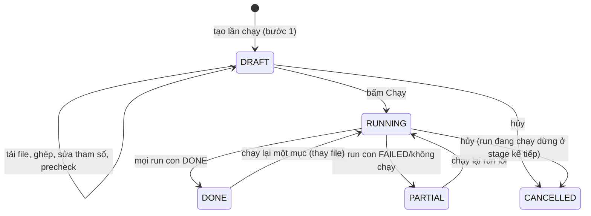

# Spec 10 – Bộ đối soát và chạy theo bộ (Batch Run)

_Phiên bản 1.0. Bổ sung cho v4 (spec 00–08) và gói Lookups (spec 09). Không thay đổi engine so sánh: mỗi template trong một lần chạy bộ vẫn tạo **một run bình thường** (spec 04 mục 9)._

## 1. Mục tiêu và phạm vi

Mỗi tháng đối soát khoảng 20 hệ thống, mỗi hệ thống một template và bộ tham số riêng. Chức năng cho phép:
- Khai báo **Bộ đối soát** một lần: danh sách template đã đăng ký, mẫu tên file, gộp nhiều file, bắt buộc, tham số ghi đè (có công thức theo kỳ).
- Mỗi kỳ: chọn bộ → nhập kỳ chung → kéo thả tất cả file → hệ thống ghép file vào template → soát tham số → kiểm tra trước → chạy toàn bộ.
- Xem kết quả tổng hợp, chạy lại run lỗi, tải .zip gồm các file riêng, đánh dấu kiểm tra và xóa dữ liệu tạm theo nhóm.

**Quyết định đã chốt (04/11/2026):**
| # | Quyết định |
|---|---|
| D1 | Một hệ thống có thể xuất **nhiều file mỗi tháng** → template trong bộ có cờ `MULTI_FILE`; các file được **gộp** trước khi đọc |
| D2 | Mọi template trong bộ chạy **cùng một kỳ**. Template có kỳ khác hẳn thì **chạy riêng** ở màn Chạy đối soát (1 file), không đưa vào bộ. Cho phép lệch vài ngày bằng công thức (`{ky.tu-1d}`) |
| D3 | Các template **không phụ thuộc** nhau, chạy song song có giới hạn |
| D4 | Xuất kết quả là **file riêng** từng template, đóng gói .zip kèm một file tổng hợp; không gộp chi tiết vào một file |
| D5 | Bộ **tham chiếu** template đã đăng ký, không sao chép cấu hình. Luôn dùng version **Active mới nhất** tại thời điểm chạy |

**Ngoài phạm vi:** lịch chạy tự động; lấy file từ thư mục/SFTP/SharePoint; phụ thuộc thứ tự giữa template; kỳ khác nhau trong cùng một lần chạy bộ; gộp chi tiết nhiều template vào một file export.

## 2. Thuật ngữ

| Thuật ngữ | Nghĩa |
|---|---|
| Bộ đối soát (batch definition) | Cấu hình dùng lại: danh sách template + cách chạy từng template |
| Mục của bộ (batch item) | Một template trong bộ, kèm mẫu tên file, gộp, bắt buộc, tham số ghi đè |
| Lần chạy bộ (batch run) | Một lần chạy của bộ cho một kỳ |
| Run con | Run bình thường (`RECON_RUN`) sinh ra cho từng mục trong lần chạy bộ |
| Kỳ (period) | Tháng `YYYY-MM`; sinh `ky.tu` = ngày 1 00:00:00, `ky.den` = ngày cuối 23:59:59 (giờ Việt Nam) |

## 3. Mô hình dữ liệu

Định nghĩa trong `app/db/metadata.py`, kiểu trung lập theo spec 02 mục 0. Alembic revision mới (không sửa revision cũ), chạy được trên SQLite (batch mode) và Oracle. Chi tiết cột ở `docs/specs/10_batch_run_tables.md`.

| Bảng | Vai trò |
|---|---|
| `RECON_BATCH_DEF` | Bộ đối soát |
| `RECON_BATCH_DEF_ITEM` | Template trong bộ và cách chạy |
| `RECON_BATCH_RUN` | Lần chạy bộ theo kỳ |
| `RECON_BATCH_RUN_ITEM` | Snapshot từng mục lúc chạy: version, tham số đã tính, trạng thái, run hiện hành |
| `RECON_BATCH_RUN_FILE` | File đã ghép vào mục (nhiều file khi gộp) |
| `RECON_RUN` (+ cột) | Thêm `BATCH_RUN_ID`, `BATCH_RUN_ITEM_ID` (nullable) |
| `RECON_EXCEL_LOAD` (+ cột) | Thêm `SOURCE_FILES_JSON` (danh sách file đã gộp) |

**Nguyên tắc:**
- Bộ chỉ lưu tham chiếu `TEMPLATE_ID`; không lưu mapping, nguồn DB, profile.
- Lần chạy bộ lưu **snapshot** (version template, tham số đã tính ra giá trị thật, file đã ghép) để truy vết dù sau này bộ hoặc template thay đổi.
- Run con là run bình thường; mọi chức năng hiện có (kết quả, issue, export, xóa dữ liệu tạm, chuyển Oracle) áp dụng không đổi.

## 4. Quy tắc khai báo bộ

### 4.1 Thêm template vào bộ
- Chỉ thêm template `STATUS='ACTIVE'` và chưa có trong bộ. Draft: "Cần dry-run và kích hoạt trước". Archived: không thêm.
- Mỗi template xuất hiện **tối đa một lần** trong một bộ (UQ `BATCH_DEF_ID, TEMPLATE_ID`). Một template có thể nằm trong nhiều bộ.
- Mẫu tên file gợi ý sẵn từ mã template (`*<2 cụm đầu của mã>*`), bắt buộc nhập trước khi lưu.
- Gỡ template khỏi bộ: xóa dòng `RECON_BATCH_DEF_ITEM` nếu chưa có lần chạy tham chiếu; nếu đã có thì **xóa mềm** (`IS_ACTIVE='N'`) để giữ lịch sử.

### 4.2 Template thay đổi sau khi đã vào bộ
| Sự kiện | Hành vi |
|---|---|
| Kích hoạt version mới | Lần chạy bộ sau dùng version mới; run con ghi version đã dùng |
| Template bị Archive | Mục hiện cảnh báo "Archived"; khi chạy bị bỏ qua với lý do `TEMPLATE_ARCHIVED` |
| Template đổi danh sách tham số | Tham số ghi đè không còn tồn tại → lỗi `BATCH_PARAM_UNKNOWN` ở màn bộ và chặn chạy mục đó |

### 4.3 Mẫu tên file
- Cú pháp glob đơn giản: `*` khớp mọi chuỗi; nhiều mẫu cách nhau bằng `|` (ví dụ `*DTP*|*HOA_DON_TAC_NGHIEP*`).
- So khớp trên **tên file đã chuẩn hóa**: bỏ đuôi, bỏ dấu tiếng Việt, chữ HOA, chỉ giữ A–Z, 0–9 (`_ - . khoảng trắng` bị bỏ). Mẫu cũng chuẩn hóa như vậy.
- Lưu ý khi khai báo: các mẫu trong bộ **không nên chồng nhau**; màn bộ cảnh báo khi hai mẫu cùng khớp một tên file ví dụ (kiểm bằng danh sách tên file của lần chạy gần nhất).

### 4.4 Tham số
Thứ tự ưu tiên (cao thắng thấp):
1. Ghi đè khi chạy (bước 3 của màn chạy) – chỉ áp dụng cho lần chạy đó.
2. Tham số ghi đè trong bộ (`PARAMS_OVERRIDE_JSON`).
3. Mặc định trong template (`db_source.params[].default`).
4. Riêng `p_from`, `p_to`: mặc định `{ky.tu}`, `{ky.den}`.

**Công thức** (chỉ trong chuỗi giá trị, đánh giá ở backend):

| Biểu thức | Kết quả (kỳ 2026-10) | Kiểu |
|---|---|---|
| `{ky.tu}` | 2026-10-01 00:00:00 | datetime |
| `{ky.den}` | 2026-10-31 23:59:59 | datetime |
| `{ky.tu±Nd}`, `{ky.den±Nd}` | cộng/trừ N ngày (N ≤ 31) | datetime |
| `{ky.thang}` | `202610` | text |
| `{ky.nam}` | `2026` | text |

- Không cho phép biểu thức khác, không gọi hàm, không `eval`. Parser là regex cố định; ngoài cú pháp trên → `BATCH_FORMULA_INVALID`.
- Giá trị sau khi tính được ép theo kiểu tham số của template (datetime/date/text/number). Sai kiểu → `BATCH_PARAM_TYPE`.
- Tham số `required` của template mà giá trị cuối cùng rỗng → `BATCH_PARAM_REQUIRED`.
- `p_from ≤ p_to` và khoảng ≤ `max_range_days` của template (kiểm như run đơn lẻ).

## 5. Quy trình chạy bộ

Trạng thái `RECON_BATCH_RUN.STATUS`:

Trạng thái `RECON_BATCH_RUN_ITEM.STATUS`: `PENDING` (chưa đủ điều kiện) → `READY` / `WARN` / `ERROR` (sau precheck) / `SKIPPED` → `QUEUED` → `RUNNING` → `DONE` / `FAILED`. `NOT_RUN` khi mục ERROR hoặc WARN không được chọn chạy.

### 5.1 Bước 1 – Chọn bộ và kỳ
- Chỉ bộ `STATUS='ACTIVE'`. Kỳ bắt buộc. Tạo `RECON_BATCH_RUN` ở trạng thái `DRAFT` và các `RECON_BATCH_RUN_ITEM` (snapshot mục đang hoạt động; mục có template Archived → `SKIPPED`, `SKIP_REASON='TEMPLATE_ARCHIVED'`).
- Đã có lần chạy cùng bộ + kỳ: cảnh báo, vẫn cho tạo lần chạy mới (không ghi đè).
- Lần chạy DRAFT được lưu: người dùng rời trang rồi quay lại vẫn tiếp tục được. DRAFT quá 7 ngày không thao tác hiện nhãn "Bỏ dở" trong lịch sử (không tự xóa).

### 5.2 Bước 2 – Tải và ghép file
- Kéo thả nhiều file hoặc .zip. Mỗi file lưu theo SHA-256 như upload hiện có (spec 06 mục 4). File .zip được giải nén phía server (chặn zip bomb, bỏ thư mục ẩn, chỉ nhận .xlsx/.xls/.csv bên trong; đường dẫn trong zip không được thoát thư mục tạm).
- File trùng tên trong cùng lần chạy: bỏ qua và báo. File trùng nội dung (cùng hash, khác tên): cảnh báo, người dùng chọn giữ hoặc bỏ.
- Thuật toán ghép cho từng file:
  1. Khớp mẫu tên file của các mục **đang hoạt động** → 1 mục: ghép tự động; nhiều mục: `AMBIGUOUS`; không mục nào: bước 2.
  2. Khớp `detect_by_headers` của template (đọc header sheet đầu tiên) → 1 mục: ghép, đánh dấu `MATCH_BY='HEADER'`; còn lại: `UNMATCHED`.
  3. Người dùng chọn tay → `MATCH_BY='MANUAL'`; hoặc bỏ file.
- Kiểm tra theo mục:
  | Tình trạng | Xử lý |
  |---|---|
  | Không có file, `IS_REQUIRED='Y'` | Chặn bước tiếp, cho chọn "Bỏ qua tháng này" (`SKIP_REASON='USER_SKIP'`, ghi người bỏ qua) |
  | Không có file, `IS_REQUIRED='N'` | Tự `SKIPPED`, `SKIP_REASON='NO_FILE'` |
  | ≥ 2 file, `MULTI_FILE='N'` | Chặn, người dùng bỏ bớt file hoặc chuyển file sang mục khác |
  | ≥ 2 file, `MULTI_FILE='Y'` | Gộp (mục 5.6) |
- Chỉ sang bước 3 khi không còn file `AMBIGUOUS`/`UNMATCHED` chưa xử lý và không còn mục bắt buộc thiếu file.

### 5.3 Bước 3 – Tham số
- Hiển thị cho mọi mục có file: `p_from`, `p_to`, tham số khác; mỗi ô có biểu thức và giá trị đã tính.
- Sửa ô → lưu vào `PARAMS_RUN_OVERRIDE_JSON` của run item (không đổi bộ, không đổi template). Nút "Về mặc định" xóa ghi đè.
- Lưu `PARAMS_RESOLVED_JSON` (giá trị cuối cùng, kiểu chuẩn) ngay khi hợp lệ.

### 5.4 Bước 4 – Kiểm tra trước (precheck)
Chạy song song có giới hạn (cùng giới hạn của bước 5) cho mọi mục có file. Không ghi dữ liệu tạm, không lưu kết quả. Mỗi mục:

| Kiểm tra | Mức |
|---|---|
| Template còn Active, lấy version Active | ERROR nếu không |
| Đọc được mọi file, đúng sheet, đủ cột bắt buộc | ERROR |
| Gộp file: header các file khớp nhau | ERROR |
| Control total (từng file) | WARN nếu lệch |
| Số dòng ngoài kỳ | WARN nếu > 0 |
| Số dòng không hợp lệ | WARN nếu > 0 |
| Kết nối Data Source (cache kết quả kiểm theo Data Source trong lần precheck) | ERROR |
| Tham số hợp lệ (mục 4.4) | ERROR |

- Ghi `PRECHECK_JSON` (từng kiểm tra, số dòng, control total) và `STATUS` = READY/WARN/ERROR.
- Mục ERROR có nút "Thay file": thay file của riêng mục đó và precheck lại riêng mục đó.
- Tùy chọn "Chạy cả mục có cảnh báo" (mặc định bật). Nút chạy ghi rõ số mục sẽ chạy. Mục ERROR (và WARN nếu tắt tùy chọn) → `NOT_RUN` khi bấm Chạy.

### 5.5 Bước 5 – Thực thi
- Bấm Chạy: trong một transaction, chuyển batch run sang RUNNING, tạo `RECON_RUN` cho từng mục được chạy (QUEUED, có `BATCH_RUN_ID`, `BATCH_RUN_ITEM_ID`, tham số từ `PARAMS_RESOLVED_JSON`, `TEMPLATE_VERSION` = version Active lúc này), enqueue vào `RECON_RUN_QUEUE`, ghi `CURRENT_RUN_ID` vào run item.
- **Giới hạn song song theo Data Source**: worker khi claim job bỏ qua run có `BATCH_RUN_ID` mà số run RUNNING cùng `DATA_SOURCE_ID` và cùng batch run đã ≥ `MAX_PARALLEL_PER_DS` (mặc định 2, khai báo ở bộ, 1–4). Run không thuộc bộ không bị giới hạn này.
- **Ưu tiên**: thứ tự claim theo `RECON_BATCH_DEF_ITEM.PRIORITY` (nhỏ chạy trước), rồi thứ tự mục.
- **SQLite**: đọc file, gộp, truy vấn Oracle, so sánh chạy song song giữa các worker; bước SAVE ghi theo lô và commit ngắn (rule database), nên chỉ một luồng ghi tại một thời điểm.
- Một run con FAILED không ảnh hưởng run khác. Batch run kết thúc khi mọi run con DONE/FAILED: DONE nếu tất cả DONE và không có mục NOT_RUN bắt buộc, ngược lại PARTIAL.
- Người dùng rời trang được; tiến độ đọc từ DB (dcc.Interval 2 giây).

### 5.6 Gộp nhiều file vào một mục
- Mọi file của mục đọc bằng cùng FileSpec của template; header phải khớp (so theo danh sách trường logic đã map), khác → ERROR `BATCH_MERGE_HEADER_MISMATCH` chỉ rõ file nào thiếu/thừa cột.
- Thêm cột kỹ thuật `__source_file` (tên file) và `__row_no` giữ số dòng trong **từng file**; chi tiết dòng Excel ở màn kết quả hiện "file · dòng".
- Control total kiểm **từng file** (mỗi file có dòng tổng riêng); tổng cộng hiển thị cộng dồn.
- `RECON_EXCEL_LOAD.SOURCE_FILES_JSON` lưu danh sách `{file_id, name, rows, control_total_ok}`; UQ của EXCEL_LOAD đổi sang dùng `FILE_SET_HASH` (hash của danh sách SHA-256 đã sắp xếp + sheet + template + version). Với run 1 file, `FILE_SET_HASH` = hash của 1 file (tương thích ngược; migration tính lại cho dữ liệu cũ).
- Khóa trùng giữa hai file (cùng số hóa đơn ở hai file) được xử lý như trong một file: profile gộp thì cộng dồn; profile `aggregate=false` thì DUPLICATE.

### 5.7 Chạy lại
| Thao tác | Hành vi |
|---|---|
| Chạy lại run lỗi | Với mỗi mục FAILED: tạo run con mới (cùng file, cùng tham số đã tính), cập nhật `CURRENT_RUN_ID`, tăng `ATTEMPT_NO`. Run cũ giữ nguyên trong lịch sử |
| Thay file và chạy lại một mục | Thay file của mục (batch run phải không RUNNING cho mục đó), precheck mục đó, chạy run mới. Áp dụng cả khi mục đã DONE (sửa file sai) |
| Chạy lại toàn bộ | Không hỗ trợ; tạo lần chạy bộ mới |
- Dữ liệu tạm của run cũ bị thay thế vẫn theo cơ chế chủ động xóa (spec 04 mục 12).

## 6. Kết quả lần chạy bộ

- Đầu trang: tên lần chạy, bộ, kỳ, người chạy, thời gian, "n/N mục có kết quả".
- KPI: Khớp hết · Có lệch (kèm tổng tiền chênh của main measure) · Lỗi/chưa chạy · Bỏ qua.
- Ma trận mỗi dòng một mục: template, số file, trạng thái, Tổng Excel, Tổng DB, Chênh lệch (main measure của profile mặc định), Khớp, Lệch, Thiếu DB, Thiếu Excel, so với lần chạy DONE gần nhất của cùng bộ ở kỳ trước (chênh lệch tỷ lệ khớp), Kiểm tra, thao tác (Mở run, Tải file).
- Số liệu lấy từ `RECON_RUN_SUMMARY` của `CURRENT_RUN_ID`; không tính lại.
- Thao tác chọn nhiều: Đánh dấu đã kiểm tra (tùy chọn xóa luôn dữ liệu tạm) · Xóa dữ liệu tạm (gõ XOA, chỉ Admin). Gọi lại service hiện có (`run.mark_checked`, `temp_data.purge_runs`) cho từng run con.
- **Tải tất cả (.zip)**: worker sinh file `<MA_BO>_<YYYYMM>_<BATCH_RUN_ID>.zip` vào `storage/batch/<BATCH_RUN_ID>/`, gồm:
  - `00_TONG_HOP_<YYYYMM>.xlsx`: một dòng mỗi mục (cột như ma trận) + sheet "Tham số" (tham số đã tính từng mục) + sheet "File" (file đã ghép từng mục).
  - `<NN>_<MA_TEMPLATE>_<YYYYMM>.xlsx` cho mỗi mục có kết quả: **giống hệt** export của run (spec 04 mục 10).
  - Mục lỗi/bỏ qua không có file; được liệt kê trong file tổng hợp với lý do.
  - Sinh lần đầu khi bấm, cache theo `(BATCH_RUN_ID, danh sách CURRENT_RUN_ID)`; chạy lại một mục thì cache bị vô hiệu.
- Màn Lịch sử hiện có thêm bộ lọc "Lần chạy bộ"; run con có chip tên bộ.

## 7. Phân quyền

| Thao tác | AD | TO | OP | VW |
|---|---|---|---|---|
| Tạo/sửa/archive bộ, thêm/gỡ template | Có | Có | | |
| Tạo lần chạy bộ, tải file, sửa tham số khi chạy, chạy, chạy lại | Có | Có | Có | |
| Xem lần chạy bộ, tải .zip | Có | Có | Có | Có |
| Đánh dấu đã kiểm tra (+ xóa dữ liệu tạm của run đó) | Có | Có | Có | |
| Xóa dữ liệu tạm hàng loạt | Có | | | |
| Hủy lần chạy bộ | Có | Có | Người tạo | |

Kiểm quyền trong service. Chạy trên Data Source `ENV='PROD'`: xác nhận một lần cho cả lần chạy bộ (liệt kê các Data Source PROD liên quan).

## 8. Service

| Service | Hàm |
|---|---|
| `batch_def` | `list(ctx, q, status)`, `get(ctx, id)`, `create(ctx, dto)`, `update(ctx, id, dto, row_version)`, `archive(ctx, id)`, `add_items(ctx, id, items)`, `update_item(ctx, item_id, dto, row_version)`, `remove_item(ctx, item_id)`, `addable_templates(ctx, id, q, include_unavailable)`, `preview_params(ctx, id, period)` |
| `batch_run` | `create(ctx, batch_def_id, period, name)`, `get(ctx, id)`, `list(ctx, filter, page)`, `add_files(ctx, id, uploads)`, `assign_file(ctx, run_file_id, item_id \| None)`, `ignore_file(ctx, run_file_id)`, `skip_item(ctx, item_id, skip)`, `set_param_override(ctx, item_id, key, value \| None)`, `precheck(ctx, id, item_ids=None)`, `replace_files(ctx, item_id, uploads)`, `start(ctx, id, include_warn, confirm_prod)`, `retry_failed(ctx, id)`, `rerun_item(ctx, item_id)`, `cancel(ctx, id)`, `matrix(ctx, id)`, `build_zip(ctx, id)` |
| `batch_formula` (thuần) | `resolve(expr, period) -> str`, `resolve_params(template_params, def_override, run_override, period) -> dict` |
| `batch_matcher` (thuần) | `normalize_name(name)`, `match(file_name, items) -> list[item_id]` |

Tất cả trả `ServiceResult`. Thao tác thay đổi dữ liệu dùng `ROW_VERSION` (STALE_DATA khi hai người cùng sửa lần chạy DRAFT).

**Mã lỗi mới** (`app/schemas/errors.py`):
`BATCH_NOT_FOUND, BATCH_NOT_ACTIVE, BATCH_TEMPLATE_EXISTS, BATCH_TEMPLATE_NOT_ACTIVE, BATCH_ITEM_PATTERN_REQUIRED, BATCH_FORMULA_INVALID, BATCH_PARAM_UNKNOWN, BATCH_PARAM_TYPE, BATCH_PARAM_REQUIRED, BATCH_FILE_DUPLICATE, BATCH_FILE_AMBIGUOUS, BATCH_FILE_UNMATCHED, BATCH_ITEM_MISSING_FILE, BATCH_ITEM_TOO_MANY_FILES, BATCH_MERGE_HEADER_MISMATCH, BATCH_ZIP_INVALID, BATCH_RUN_NOT_DRAFT, BATCH_RUN_BUSY, BATCH_NOTHING_TO_RUN`.

## 9. Màn hình (Dash)

| Path | Page | Thiết kế | Quyền |
|---|---|---|---|
| `/batches` | `pages/batch_defs.py` (danh sách bộ) | Screen13 (mở rộng) | mọi role |
| `/batches/<id>` | `pages/batch_def_edit.py` | Screen13 › Bộ đối soát | TO, AD sửa; còn lại xem |
| `/batch-runs/new?def=<id>` và `/batch-runs/<id>` (DRAFT/RUNNING) | `pages/batch_run_wizard.py` | Screen13 › Chạy bộ đối soát | OP, TO, AD |
| `/batch-runs/<id>/result` | `pages/batch_run_result.py` | Screen13 › Kết quả lần chạy bộ | mọi role |

Menu: nhóm Đối soát thêm "Chạy bộ đối soát"; nhóm Cấu hình thêm "Bộ đối soát". Prototype: `designs/components/Screen13-BatchRun/preview.html`.

Quy tắc UI (theo rule `ui-dash`):
- Bảng ghép file, tham số, precheck, kết quả dùng `dag.AgGrid` (≥ 20 dòng, cần lọc/sắp xếp); hộp thoại thêm template dùng `dmc.Modal` size xl.
- Upload nhiều file: `dcc.Upload(multiple=True)`; file lớn tải lần lượt, hiện tiến độ từng file; lỗi một file không hủy các file khác.
- Wizard lưu trạng thái ở DB (batch run DRAFT), không chỉ ở `dcc.Store`; tải lại trang không mất công việc.
- Nút chính ở mỗi bước ghi rõ hành động và số lượng ("Chạy 18 template"); lý do bị khóa hiện cạnh nút.
- Đủ 4 trạng thái (đang tải, trống, lỗi giữ dữ liệu cũ, bình thường) cho từng bảng.

## 10. Hiệu năng và giới hạn

| Hạng mục | Giới hạn mặc định |
|---|---|
| Số mục mỗi bộ | ≤ 50 |
| Số file mỗi lần chạy bộ | ≤ 200; mỗi file ≤ 50 MB; .zip ≤ 200 MB, giải nén ≤ 1 GB |
| File mỗi mục (gộp) | ≤ 50 |
| Song song mỗi Data Source trong một lần chạy bộ | 1–4 (mặc định 2) |
| Precheck | đọc header + dòng tổng + đếm dòng; không chạy so sánh |

Mục tiêu: precheck 20 mục ≤ 60 giây (không tính truy vấn qua VPN); tạo 20 run con ≤ 2 giây.

## 11. Audit

Ghi `RECON_AUDIT_LOG` trong cùng transaction: tạo/sửa/archive bộ; thêm/gỡ/sửa mục; tạo lần chạy bộ; bỏ qua mục; ghi đè tham số khi chạy; bắt đầu chạy (kèm danh sách mục chạy, mục không chạy và lý do); chạy lại; thay file; hủy; tải .zip.

## 12. Chuyển sang Oracle (spec 08)

Thêm vào thứ tự chép, sau `RECON_TEMPLATE_VERSION` và `RECON_FILE`: `RECON_BATCH_DEF`, `RECON_BATCH_DEF_ITEM`; sau `RECON_RUN`: `RECON_BATCH_RUN`, `RECON_BATCH_RUN_ITEM`, `RECON_BATCH_RUN_FILE`. Vì `RECON_BATCH_RUN_ITEM.CURRENT_RUN_ID` và `RECON_RUN.BATCH_RUN_ITEM_ID` tham chiếu vòng: chép `RECON_RUN` với `BATCH_RUN_ITEM_ID = NULL`, chép batch, rồi cập nhật lại cột này theo lô. Phạm vi CONFIG_ONLY gồm `RECON_BATCH_DEF`, `RECON_BATCH_DEF_ITEM`.

## 13. Kiểm thử

| Nhóm | Ca |
|---|---|
| Công thức (unit) | `{ky.tu}`, `{ky.den}`, ±Nd qua tháng/năm, tháng 2 năm nhuận, `{ky.thang}`, `{ky.nam}`, biểu thức lạ → lỗi, không thực thi mã |
| Ghép file (unit) | chuẩn hóa tên có dấu/khoảng trắng; nhiều mẫu `\|`; khớp 0/1/nhiều; khớp theo header; file trùng tên, trùng hash; .zip lồng thư mục, zip slip, zip bomb |
| Gộp (golden mới G14) | 3 file DTP (mỗi file có dòng tổng) gộp → kết quả bằng chạy 1 file đã nối tay; header lệch → lỗi chỉ đúng file; trùng khóa giữa 2 file |
| Service | quyền từng vai trò; ROW_VERSION; template Archived/Draft; tham số không tồn tại; mục bắt buộc thiếu file chặn bước 3 |
| Worker | 20 run con, giới hạn 2/Data Source không vượt; ưu tiên; 1 run lỗi không ảnh hưởng; chạy lại run lỗi tạo run mới và cập nhật CURRENT_RUN_ID; SQLite 2 worker không `database is locked` |
| Export | .zip đủ file, tên đúng, file con giống export run, file tổng hợp có sheet Tham số và File |
| Migration | revision chạy 2 lần; downgrade/upgrade; `FILE_SET_HASH` tính đúng cho dữ liệu cũ; chuyển Oracle giữ liên kết vòng |
| E2E | Admin tạo bộ 5 template (sample DTP + 4 template giả) → Operator chạy bộ với 7 file (1 mục gộp 3 file, 1 file khớp nhiều mục, 1 file không khớp, 1 mục bắt buộc bỏ qua) → precheck có WARN/ERROR → thay file → chạy → kết quả → chạy lại run lỗi → tải .zip → đánh dấu kiểm tra |
