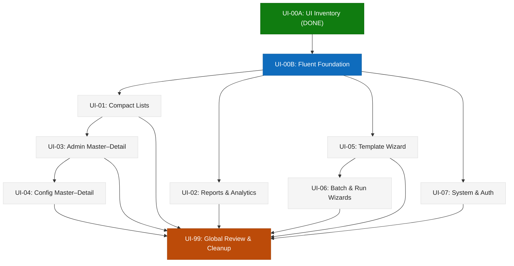

# ReconHub — UI Migration Backlog Index

Chỉ mục theo dõi toàn bộ quá trình chuyển đổi giao diện ReconHub sang phong cách **Fluent Compact + Master–Detail** theo quy định tại `AGENTS.md`, `.agents/rules/ui-dash.md`, `designs/tokens.json` và kết quả kiểm kê tại `docs/ui-migration.md`.

> [!IMPORTANT]
> **EXECUTION POLICY**:
> - AI chỉ được phép thực hiện task khi người dùng chỉ định chính xác Task ID (Ví dụ: `"Làm UI-00B"`, `"Làm UI-01"`).
> - Sau khi hoàn thành một task, AI **bắt buộc phải STOP**, không được tự động chuyển sang task tiếp theo hoặc tự động sửa code ngoài phạm vi task đã được duyệt.

---

## 1. Migration Backlog

| Task | Name | Status | Dependencies | Complexity | Pages / Target | Location |
|---|---|:---:|---|:---:|---|---|
| **UI-00A** | UI Inventory & Fluent Migration Assessment | ✅ DONE | — | M | Toàn bộ 26 pages (Đã kiểm kê & chụp 62 baseline screenshots) | [docs/ui-migration.md](../ui-migration.md) |
| **UI-00B** | Fluent Foundation | ✅ DONE | UI-00A | M | Foundation components (`AppShell`, `PageHeader`, `CommandBar`, `FilterBar`, `DataGrid`, `MasterDetailLayout`, `WizardShell`, `SkeletonGrid`, `ErrorState`) | [docs/tasks/UI-00B/task.md](UI-00B/task.md) |
| **UI-01** | Compact Lists | ✅ DONE | UI-00B | M | `/templates`, `/history`, `/batches`, `/report-runs`, `/reports` | [docs/tasks/UI-01/task.md](UI-01/task.md) |
| **UI-02** | Reports & Analytics | ⬜ TODO | UI-00B | L | `/`, `/runs/<id>`, `/batch-runs/<id>/result`, `/issues`, `/reports/<id>` | [docs/tasks/UI-02/task.md](UI-02/task.md) |
| **UI-03** | Admin Master–Detail | ⬜ TODO | UI-00B, UI-01 | L | `/lookups`, `/users`, `/roles`, `/menus` | [docs/tasks/UI-03/task.md](UI-03/task.md) |
| **UI-04** | Configuration Master–Detail | ⬜ TODO | UI-00B, UI-03 | XL | `/data-sources`, `/batches/<def_id>`, `/report-admin` (UI-04.1→04.4), `/templates/<id>/diagram` | [docs/tasks/UI-04/task.md](UI-04/task.md) |
| **UI-05** | Template Wizard | ⬜ TODO | UI-00B | XL | `/templates/new`, `/templates/<id>/edit` | [docs/tasks/UI-05/task.md](UI-05/task.md) |
| **UI-06** | Batch & Run Wizards | ⬜ TODO | UI-00B, UI-05 | L | `/batch-runs`, `/runs/new` | [docs/tasks/UI-06/task.md](UI-06/task.md) |
| **UI-07** | System & Auth | ⬜ TODO | UI-00B | S | `/login`, `/account`, `/forbidden`, `/suspended`, `/dev/ui` | [docs/tasks/UI-07/task.md](UI-07/task.md) |
| **UI-99** | Global UI Review & Cleanup | ⬜ TODO | UI-01 → UI-07 | L | Toàn bộ 26 trang (Phase A: Audit Only → STOP; Phase B: Fix) | [docs/tasks/UI-99/task.md](UI-99/task.md) |

---

## 2. Bảng Tra Cứu Nguồn Gốc Màn Hình (Origin Feature Tasks & Specs)

Bảng này giúp lập trình viên khi di chuyển giao diện hoặc debug lỗi có thể tra ngược về đúng **Task gốc đã sinh ra màn hình**, **Tài liệu đặc tả (Spec)** và **Thiết kế mẫu ban đầu (Design Screen)**:

| Route | Page Module | UI Migration Task | Task Gốc Sinh Ra | Spec Liên Quan | Màn Thiết Kế Gốc |
|---|---|:---:|---|---|---|
| `/` | `dashboard.py` | **UI-02** | [12-export-history](12-export-history/task.md) & [15-dashboard-compare](15-dashboard-compare/task.md) | [05_services_pages.md](../specs/05_services_pages.md) | `designs/components/Screen01-Dashboard` |
| `/templates` | `templates.py` | **UI-01** | [03-template-config](03-template-config/task.md) & [08-app-shell-ui](08-app-shell-ui/task.md) | [03_template_config.md](../specs/03_template_config.md), [05_services_pages.md](../specs/05_services_pages.md) | `designs/components/Screen02-Templates` |
| `/templates/new` | `template_wizard.py` | **UI-05** | [09-template-wizard-ui](09-template-wizard-ui/task.md) | [03_template_config.md](../specs/03_template_config.md), [05_services_pages.md](../specs/05_services_pages.md) | `designs/components/Screen03-TemplateWizard` |
| `/templates/<id>/edit` | `template_wizard.py` | **UI-05** | [09-template-wizard-ui](09-template-wizard-ui/task.md) | [03_template_config.md](../specs/03_template_config.md), [05_services_pages.md](../specs/05_services_pages.md) | `designs/components/Screen03-TemplateWizard` |
| `/templates/<id>/diagram` | `template_diagram.py` | **UI-04** | [09-template-wizard-ui](09-template-wizard-ui/task.md) | [03_template_config.md](../specs/03_template_config.md), [05_services_pages.md](../specs/05_services_pages.md) | `designs/components/Screen04-TemplateDiagram` |
| `/runs/new` | `new_run.py` | **UI-06** | [10-new-run-ui](10-new-run-ui/task.md) | [04_excel_reader.md](../specs/04_excel_reader.md), [05_services_pages.md](../specs/05_services_pages.md) | `designs/components/Screen05-NewRun` |
| `/runs/<id>` | `run_result.py` | **UI-02** | [11-run-result-ui](11-run-result-ui/task.md) | [04_recon_engine.md](../specs/04_recon_engine.md), [05_services_pages.md](../specs/05_services_pages.md) | `designs/components/Screen06-RunResult` |
| `/history` | `history.py` | **UI-01** | [12-export-history](12-export-history/task.md) | [04_excel_reader.md](../specs/04_excel_reader.md), [05_services_pages.md](../specs/05_services_pages.md) | `designs/components/Screen07-History` |
| `/batches` | `batch_defs.py` | **UI-01** | [18-batch-run](18-batch-run/task.md) | [10_batch_run.md](../specs/10_batch_run.md), [10_batch_run_tables.md](../specs/10_batch_run_tables.md) | `designs/components/Screen13-BatchRun` |
| `/batches/<def_id>` | `batch_def_edit.py` | **UI-04** | [18-batch-run](18-batch-run/task.md) | [10_batch_run.md](../specs/10_batch_run.md), [10_batch_run_tables.md](../specs/10_batch_run_tables.md) | `designs/components/Screen13-BatchRun` |
| `/batch-runs` | `batch_run_wizard.py` | **UI-06** | [18-batch-run](18-batch-run/task.md) | [10_batch_run.md](../specs/10_batch_run.md), [10_batch_run_tables.md](../specs/10_batch_run_tables.md) | `designs/components/Screen13-BatchRun` |
| `/batch-runs/<id>/result` | `batch_run_result.py` | **UI-02** | [18-batch-run](18-batch-run/task.md) | [10_batch_run.md](../specs/10_batch_run.md), [10_batch_run_tables.md](../specs/10_batch_run_tables.md) | `designs/components/Screen13-BatchRun` |
| `/issues` | `issues.py` | **UI-02** | [14-issue-handling](14-issue-handling/task.md) | [05_services_pages.md](../specs/05_services_pages.md) | `designs/components/Screen09-Issues` |
| `/reports` | `reports.py` | **UI-01** | [27-reporting-ui](27-reporting-ui/task.md) | [05_services_pages.md](../specs/05_services_pages.md), task 21-27 | `designs/components/Screen16-DynamicReporting` |
| `/reports/<id>` | `report_viewer.py` | **UI-02** | [27-reporting-ui](27-reporting-ui/task.md) | [05_services_pages.md](../specs/05_services_pages.md), task 23-25 | `designs/components/Screen16-DynamicReporting` |
| `/report-runs` | `report_runs.py` | **UI-01** | [25-reporting-execution](25-reporting-execution/task.md) & [27-reporting-ui](27-reporting-ui/task.md) | task 25-27 | `designs/components/Screen16-DynamicReporting` |
| `/report-admin` | `report_admin.py` | **UI-04** | [21-reporting-core](21-reporting-core/task.md) → [27-reporting-ui](27-reporting-ui/task.md) | task 21-27 | `designs/components/Screen16-DynamicReporting` |
| `/data-sources` | `data_sources.py` | **UI-04** | [02-data-sources](02-data-sources/task.md), [08-app-shell-ui](08-app-shell-ui/task.md) & [13-metadata-migration](13-metadata-migration/task.md) | [02_database_schema.md](../specs/02_database_schema.md), [08_metadata_migration.md](../specs/08_metadata_migration.md) | `designs/components/Screen08-DataSources` |
| `/lookups` | `lookups.py` | **UI-03** | [17-lookup-codes](17-lookup-codes/task.md) | task 17 | `designs/components/Screen12-Lookups` |
| `/users` | `users.py` | **UI-03** | [01-auth-users](01-auth-users/task.md) & [08-app-shell-ui](08-app-shell-ui/task.md) | [01_architecture_adr.md](../specs/01_architecture_adr.md), [05_services_pages.md](../specs/05_services_pages.md) | `designs/components/Screen11-Users` |
| `/roles` | `roles.py` | **UI-03** | [19-menu-permission](19-menu-permission/task.md) | [11_menu_permission.md](../specs/11_menu_permission.md), [11_menu_permission_tables.md](../specs/11_menu_permission_tables.md) | `designs/components/Screen14-Permission` |
| `/menus` | `menus.py` | **UI-03** | [20-menu-admin](20-menu-admin/task.md) | [11_menu_permission.md](../specs/11_menu_permission.md) | `designs/components/Screen15-MenuAdmin` |
| `/login` | `login.py` | **UI-07** | [01-auth-users](01-auth-users/task.md) & [08-app-shell-ui](08-app-shell-ui/task.md) | [01_architecture_adr.md](../specs/01_architecture_adr.md), [06_security_ops.md](../specs/06_security_ops.md) | `designs/components/Screen10-Login` |
| `/account` | `account.py` | **UI-07** | [01-auth-users](01-auth-users/task.md) (đổi mật khẩu) | [01_architecture_adr.md](../specs/01_architecture_adr.md), [06_security_ops.md](../specs/06_security_ops.md) | `designs/components/Screen10-Login` |
| `/forbidden` | `forbidden.py` | **UI-07** | [01-auth-users](01-auth-users/task.md) & [19-menu-permission](19-menu-permission/task.md) | [05_services_pages.md](../specs/05_services_pages.md) | — |
| `/suspended` | `suspended.py` | **UI-07** | [19-menu-permission](19-menu-permission/task.md) & [20-menu-admin](20-menu-admin/task.md) | [11_menu_permission.md](../specs/11_menu_permission.md) | — |
| `/dev/ui` | `dev_gallery.py` | **UI-07** | [08-app-shell-ui](08-app-shell-ui/task.md) | — | `designs/components/Gallery` |

---

## 3. Dependency Graph

